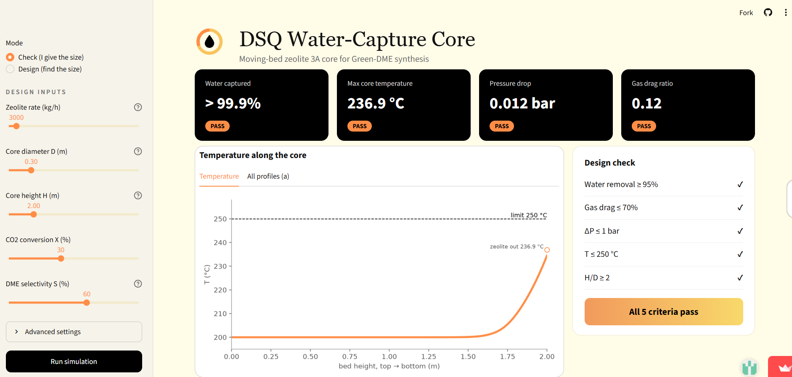

# DSQ Water-Capture Core

Moving-bed zeolite 3A core for Green-DME synthesis — CPE 100 project
(DSQ = Donut-Screw-Quick Swap reactor, IIGAC 2026 Linde × KMUTT ChE).

**Web app:** https://dsq-water-capture.streamlit.app



## Run on your own computer (Windows, PowerShell)
```powershell
cd "C:\path\to\dsq_water_capture"            # the folder with part1_zeolite and part2_core
python -m venv .venv
.venv\Scripts\Activate.ps1                    # if blocked: Set-ExecutionPolicy -Scope Process Bypass
python -m pip install -r requirements.txt
python -m streamlit run part2_core/app.py     # opens http://localhost:8501
```

## Tests (23 Nov 2026, code as on GitHub `main`)
```powershell
cd part1_zeolite;  python test_zeolite.py     # 35 / 35 tests passed
cd ..\part2_core;  python test_core.py        # 49/49 passed, 0 failed (no test is skipped)
```

| Part | Folder | Tests |
|---|---|---|
| Part 1 — zeolite 3A (Sips / GSTA isotherms, LDF) + gas entering the core | `part1_zeolite/` | 35/35 |
| Part 2 — counter-current moving-bed core, screw, design mode, web page | `part2_core/` | 49/49 (incl. 8 integration tests with Part 1) |

## Base case (check mode: D 0.30 m × H 2.0 m, zeolite 3000 kg/h, X 30 %, S 60 %, 30 bar)
Water captured > 99.9 %, max core temperature 236.9 °C, pressure drop 0.012 bar,
gas drag ratio 0.12 — all 5 design criteria pass. Design mode (about 1.5 min on
Streamlit Cloud): lowest zeolite rate 2,204 kg/h at a 200 °C zeolite feed;
smallest core 0.20 × 0.75 m, recommended core (k_LDF × 0.5) 0.20 × 1.48 m.

**Why the card says 236.9 °C while the temperature curve ends near 234.5 °C:**
234.5 °C is the bed temperature at the bottom of the core (the last point of the
profile), while 236.9 °C is the zeolite leaving the core after the thin layer at the
bottom where it meets the 250 °C inlet gas; the model uses one temperature for gas
and pellets inside the bed, so this layer is closed by an energy balance,
T_out = T_bottom + (W_gas / W_solid)(250 − T_bottom) = 234.5 + 0.156 × 15.5 = 236.9 °C,
and the card and the T ≤ 250 °C criterion use the higher value.

More detail: `part1_zeolite/README.md` and `part2_core/README.md`.
